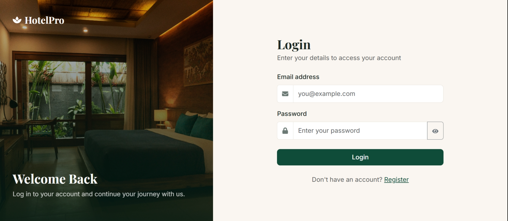
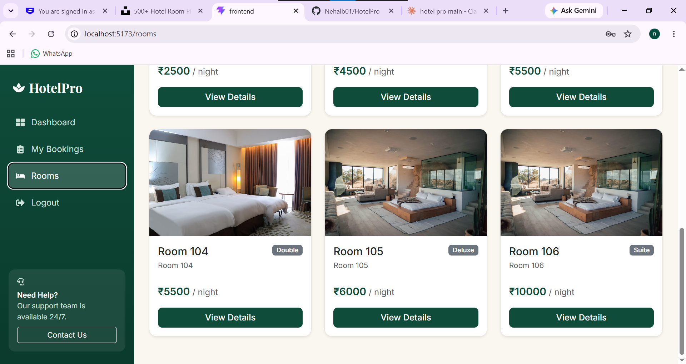
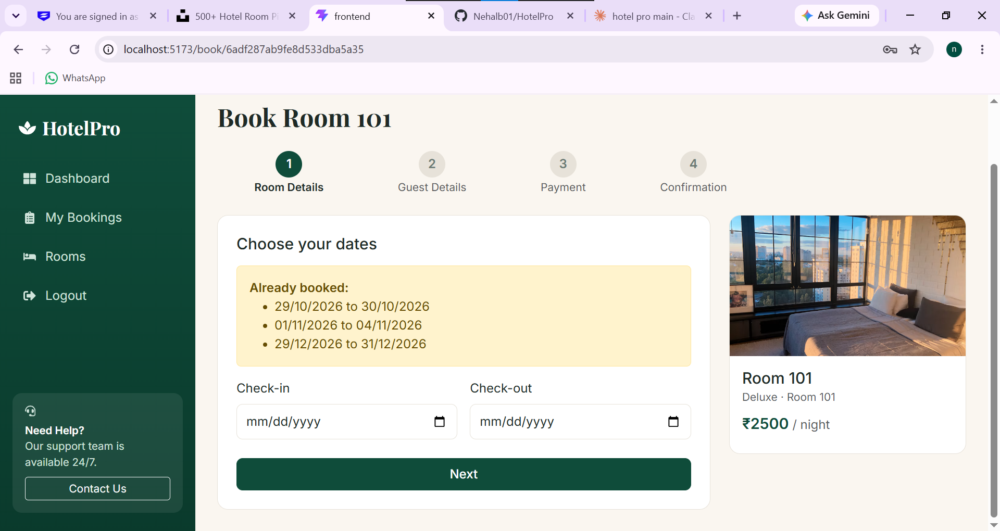
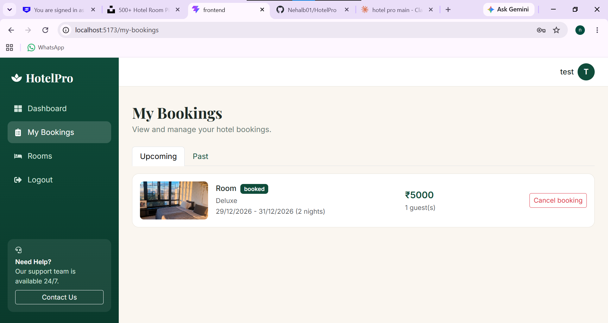
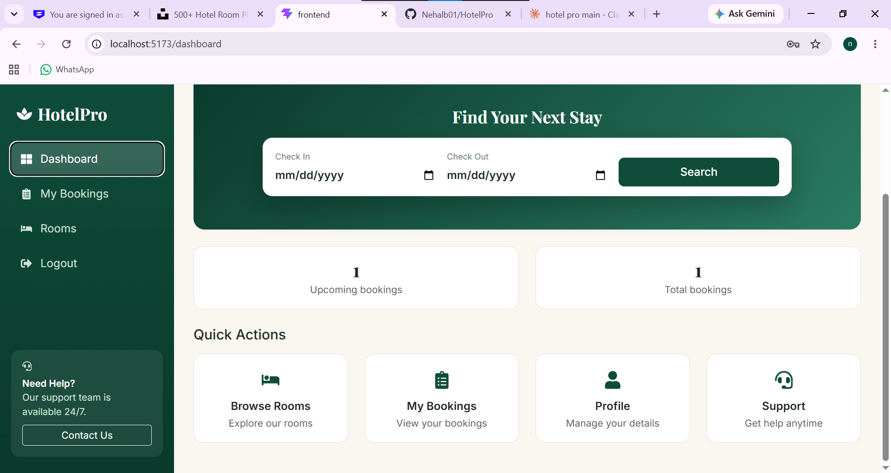

# HotelPro

A full-stack hotel booking and management system built with the MERN stack. Guests can browse rooms, check live availability and book a stay in four steps. Admins can manage rooms, bookings and users from a dashboard.

**Author:** Nehal Bhandari

**Live demo:** _add your Vercel link here after deployment_
**GitHub:**https://github.com/Nehalb01/HotelPro.git

---

## Screenshots

| Home | Rooms |
| --- | --- |
|  |  |

| Booking | My Bookings |
| --- | --- |
|  |  |

| Admin Dashboard |
| --- |
|  |

---

## Features

### Guests
- Register and log in with JWT authentication
- Search rooms by check-in and check-out dates from the home page
- Filter rooms by type (tabs), price range and keyword
- Rooms already booked for the chosen dates are hidden from results
- Room details page with description and price
- Four-step booking flow: dates, guest details, payment, confirmation
- Live price summary (nights x price per night)
- Already-booked dates are shown on the booking page, with a warning before submitting
- My Bookings with Upcoming and Past tabs, and cancellation of bookings that are not yet checked in
- Profile page to update name and phone, and change password
- Personal dashboard with a time-based greeting and quick actions

### Admin
- Admin-only routes protected on both frontend and backend
- Dashboard with total bookings, active bookings, users and revenue
- Booking management: Check-in, Check-out and Cancel
- Users list with roles
- Add, edit and delete rooms (a room with active bookings cannot be deleted)

### Technical highlights
- Double-booking prevention enforced on the server for overlapping dates
- Total price calculated on the server, not trusted from the client
- Passwords hashed with bcrypt
- Role-based access control with middleware (`protect`, `adminOnly`)
- Protected routes with token check on the frontend
- Responsive layout: sidebar collapses into a hamburger menu on phones
- Toast notifications and loading spinners

---

## Tech Stack

| Layer | Technology |
| --- | --- |
| Frontend | React (Vite), React Router, Axios, Bootstrap 5, React Icons, React Toastify |
| Backend | Node.js, Express |
| Database | MongoDB Atlas with Mongoose |
| Auth | JSON Web Tokens, bcryptjs |

---

## Project Structure

```
HotelPro/
├── backend/
│   ├── middleware/authMiddleware.js
│   ├── models/          (User, Room, Booking)
│   ├── routes/          (auth, rooms, bookings, users)
│   └── server.js
├── frontend/
│   └── src/
│       ├── components/  (Shell, Footer, Spinner, ProtectedRoute)
│       ├── pages/
│       └── services/api.js
└── screenshots/
```

---

## Getting Started

### Prerequisites
- Node.js v16 or above
- A free MongoDB Atlas cluster (or a local MongoDB)
- Git

### 1. Clone the repository

```bash
git clone https://github.com/YOUR-USERNAME/HotelPro.git
cd HotelPro
```

### 2. Set up the backend

```bash
cd backend
npm install
```

Create a file named `.env` inside `backend/` with these variables:

```
MONGO_URI=your_mongodb_connection_string
JWT_SECRET=any_long_random_text
PORT=5000
```

Start the server:

```bash
npm start
```

You should see `Server running on port 5000` and `MongoDB connected`.

> In MongoDB Atlas, open **Network Access** and make sure your IP address is allowed, otherwise the connection fails.

### 3. Set up the frontend

Open a second terminal:

```bash
cd frontend
npm install
npm run dev
```

Open http://localhost:5173.

### 4. Create an admin account

New accounts are created with the role `user`. To make an admin:

1. Register a normal account on the site.
2. In MongoDB Atlas, open **Browse Collections**, then the `users` collection.
3. Edit that user and change `role` to `admin`.
4. Log out and log in again.

The **Admin** and **Add Room** links now appear in the sidebar.

---

## API Overview

| Method | Endpoint | Access | Description |
| --- | --- | --- | --- |
| POST | `/api/auth/register` | Public | Create an account |
| POST | `/api/auth/login` | Public | Log in and receive a token |
| GET | `/api/rooms` | Public | List rooms (supports search, type, price and date filters) |
| GET | `/api/rooms/:id` | Public | Get one room |
| POST | `/api/rooms` | Admin | Add a room |
| PUT | `/api/rooms/:id` | Admin | Update a room |
| DELETE | `/api/rooms/:id` | Admin | Delete a room |
| POST | `/api/bookings` | User | Create a booking |
| GET | `/api/bookings/my` | User | My bookings |
| GET | `/api/bookings/room/:roomId/booked` | User | Booked date ranges for a room |
| PUT | `/api/bookings/:id/cancel` | User | Cancel my booking |
| GET | `/api/bookings` | Admin | All bookings |
| PUT | `/api/bookings/:id/status` | Admin | Check-in, check-out or cancel |
| GET | `/api/users` | Admin | All users |
| PUT | `/api/users/me` | User | Update my profile |
| PUT | `/api/users/me/password` | User | Change my password |

---

## Notes

- The payment step is a **demo only**. No real payment is processed, and only the card holder name, the last 4 digits and the expiry date are stored.
- Never commit your `.env` file. It is listed in `.gitignore`.

---

## Future Improvements

- Real payment gateway integration
- Email confirmations for bookings
- Room reviews and ratings
- Image upload for rooms
- Password reset by email

---

## License

This project was built for learning and portfolio purposes.